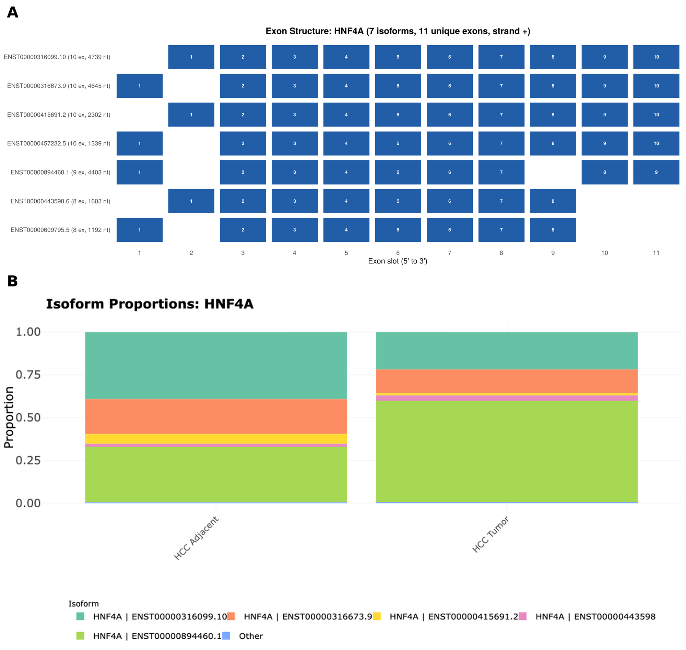

# IsoScope

*Interactive visualization of transcript isoform expression across cancer cell lines and patient cohorts*

**[Live app](https://huggingface.co/spaces/HorvathLab/IsoScope)** · **[Data (Zenodo)] (https://zenodo.org/records/23510703)** · **[Source code](https://github.com/HorvathLab/IsoScope)** · Version 2.0

## Overview

Alternative splicing can produce structurally and functionally distinct isoforms from the same gene. In BCL2L1, for example, one splicing decision produces either BCL-XL, which protects cells from apoptosis, or BCL-XS, which promotes it (Dou et al., 2021). Cancer cells exploit this kind of switch to evade therapy and adapt to new tissue environments, yet most cancer transcriptomics resources still report a single value per gene.

IsoScope is an R/Shiny application for exploring isoform-level expression without writing code. It links isoform expression to drug sensitivity, detects isoform switching, quantifies isoform diversity, shows exon-level structure, and projects patient samples onto a cell line reference.

| Dataset | Role | Samples | Groups |
|---|---|---|---|
| CCLE cancer cell lines | Reference | 668 (667 cell lines) | 26 tissues |
| Glioblastoma, pre/post G207 | Patient cohort | 6 (3 patients) | 2 |
| Hepatocellular carcinoma | Patient cohort | 15 (8 patients) | 2 |
| Prostate adenocarcinoma | Patient cohort | 48 (40 patients) | 4 |

737 samples in total, all quantified against GENCODE v49 basic (280,000 transcripts; 269,827 expressed in the CCLE reference).

**Contents:** [Use cases](#use-cases) · [Features](#features) · [Data](#data) · [Running locally](#running-locally) · [Adding a dataset](#adding-a-dataset) · [Pipeline scripts](#pipeline-scripts) · [Citation](#citation)

## Use Cases

In each example, the key signal is a change in which transcript a gene uses, even when the gene's total expression is similar.

<details>
<summary><b>Q1. Which isoform dominates in each tissue?</b> RBP1 in pancreas vs stomach cell lines</summary>

<br>


RBP1 shows similar total expression in pancreas and stomach cancer lines (~104 vs ~106 TPM), but uses different dominant transcripts. Pancreas is dominated by ENST00000672186.1 (73%), whereas stomach is dominated by ENST00000619087.5 (72%). Both are protein-coding and share the same Pfam domain, but differ in transcript structure and coding sequence length. Gene-level summaries would make these samples look nearly identical, while transcript-level analysis reveals a clear tissue-linked isoform switch.

</details>

<details>
<summary><b>Q2. How does isoform usage vary with drug response?</b> PARP1 and olaparib in TNBC cell lines</summary>

<br>


Two TNBC lines with comparable PARP1 expression (104 and 155 TPM) show markedly different olaparib sensitivity. HCC1143 (resistant, ln IC50 5.20) is almost entirely committed to canonical PARP1 ENST00000366794.10 (98%). In contrast, HCC1187 (sensitive, ln IC50 2.12) maintains a mixed isoform pool, with ENST00000874609.1 (35%) and ENST00000922080.1 (30%) exceeding the canonical transcript (27%). This contrast is also reflected in isoform diversity, with normalized Shannon entropy of 0.10 in HCC1143 versus 0.71 in HCC1187. Gene-level PARP1 expression alone would not explain this difference. Drug response overlays are hypothesis generating and do not by themselves establish isoform-driven sensitivity.

</details>

<details>
<summary><b>Q3. Does a known promoter switch show up in patient tumours?</b> HNF4A in hepatocellular carcinoma</summary>

<br>



*(A) Exon structure of HNF4A transcripts (Isoform Diversity tab). Transcripts start at one of two first exons: slot 1 (P2: ENST00000316673, 457232, 894460, 609795) or slot 2 (P1: ENST00000316099, 415691, 443598); the remaining exons are shared. (B) Mean isoform proportions in adjacent liver and tumour (Gene Viewer tab); the minor P2 transcripts are in Other.*

HNF4A, the master transcription factor of the liver, is transcribed from two promoters about 45 kb apart. The downstream promoter, P1, produces the adult isoforms of healthy liver, while the upstream promoter, P2, produces fetal-type isoforms that are induced in hepatocellular carcinoma ([Cai et al., 2017](https://doi.org/10.1177/1756283X17725998); [Fekry et al., 2018](https://doi.org/10.1038/s41467-018-06648-6)). Grouping HNF4A transcripts by where they start shows the shift in all 6 patients with paired tumour and adjacent liver samples: the share of HNF4A expression from P1 transcripts fell in every patient, from a median of 39% in adjacent liver to 25% in tumour, while the P2 share rose from 61% to 75% (paired Wilcoxon p = 0.031). Total HNF4A expression did not change significantly (DESeq2 adjusted p = 0.98), so a gene-level analysis would report no difference.

</details>

## Features

| Tab | What it does |
|---|---|
| Dataset | Choose the CCLE reference alone or with one patient cohort; each dataset keeps its own database |
| Gene Viewer | Stacked bar, grouped bar and heatmap views of isoform expression by group or sample |
| Isoform Switching | Changes in dominant isoform between groups or samples, with bootstrap confidence intervals |
| Isoform Diversity | Normalized Shannon entropy of isoform usage per gene per group, with exon structure views |
| Tissue-Specific | Transcripts predominantly expressed in one tissue or group |
| Clustering | PCA and UMAP at isoform or gene level, with patient samples projected onto the reference |
| Tissue Correlation | Pairwise correlation heatmaps across groups or samples |
| Drug Response | GDSC1/GDSC2 sensitivity overlaid on expression embeddings (hypothesis generating) |
| Differential Expression | Precomputed DESeq2 within each dataset (gene and transcript level), and runtime Wilcoxon tests, including across datasets |
| Pathway Enrichment | KEGG enrichment from DE or switching results |
| Circos | Genome-wide isoform expression with switching events |
| QC & Distribution | Per-sample quality metrics across groups |

## Data

<details>
<summary><b>Sources, processing and caveats</b></summary>

<br>

**Reference: CCLE**

- RNA-seq: 668 samples from 667 cell lines, 26 tissues (BioProject [PRJNA523380](https://www.ncbi.nlm.nih.gov/bioproject/PRJNA523380); Ghandi et al., 2019). [DepMap release for cell line annotations: TO CONFIRM]
- Alignment: STAR 2.7.2a, GRCh38, GENCODE v49 basic annotation
- Drug response: GDSC1 (378 drugs) and GDSC2 (286 drugs) via [Cell Model Passports](https://cellmodelpassports.sanger.ac.uk/downloads)

**Patient cohorts**

| Dataset | Accession | Samples | Groups | DESeq2 design |
|---|---|---|---|---|
| Glioblastoma, pre/post G207 oncolytic HSV | [GSE162643](https://www.ncbi.nlm.nih.gov/geo/query/acc.cgi?acc=GSE162643) | 6 (3 patients) | Pre-G207, Post-G207 | ~ patient + group (paired) |
| Hepatocellular carcinoma | [PRJNA1427671](https://www.ncbi.nlm.nih.gov/bioproject/PRJNA1427671) | 15 (8 patients) | Tumor, Adjacent | ~ patient + group (6 paired patients) |
| Prostate adenocarcinoma, Epworth Clinical Cohort | [GSE339157](https://www.ncbi.nlm.nih.gov/geo/query/acc.cgi?acc=GSE339157) | 48 (40 patients) | Primary bone-metastatic (BmRC), primary non-metastatic (NBmRC), bone metastasis, lymph node metastasis | ~ group |

**Caveats**

- Glioblastoma: pre-treatment samples are ribodepleted total RNA (HiSeq 4000) and post-treatment samples polyA mRNA (GAIIx), so pre/post differences combine treatment with library preparation and platform.
- Prostate: bone metastasis samples contain substantial bone marrow and blood (HBB roughly 200-fold higher than in primary tumours), so group differences in bulk data partly reflect tissue composition.

**Processing (all datasets)**

- Quantification: Salmon 1.10.0 (alignment-based mode) against GENCODE v49 basic transcripts. Patient cohorts were processed from raw reads with the Snakemake workflow in `scripts/snakemake_processing/`.
- Gene level: tximport with `countsFromAbundance = "lengthScaledTPM"`, gene symbols from GENCODE.
Differential expression: DESeq2 1.52.0 (R 4.6), run separately within each dataset with the designs above. Before testing, genes and transcripts were kept only if at least 3 samples had 10 or more reads (3 being the smallest group size).CCLE covers 319 of 325 tissue pairs.The 6 missing pairs are those in which both tissues are among the four smallest (biliary, cervix, salivary gland and small intestine), which have too few cell lines for DESeq2.
- Annotations: GENCODE v49 (biotype, exons, length, per-exon coordinates), Ensembl BioMart release 115 (UniProt, Pfam, InterPro).

</details>

## Running Locally

IsoScope can be accessed through this link (https://huggingface.co/spaces/HorvathLab/IsoScope).
To run it locally:

<details>
<summary><b>Requirements</b></summary>

<br>

- R >= 4.4
- CRAN: `shiny`, `bslib`, `ggplot2`, `plotly`, `DT`, `dplyr`, `tidyr`, `data.table`, `DBI`, `RSQLite`, `uwot`, `circlize`, `RColorBrewer`
- Bioconductor: `clusterProfiler`, `org.Hs.eg.db`
- About 10 GB of disk. On an Apple M1 laptop with 8 GB RAM, the app starts in about 17 seconds and uses about 1.6 GB of memory at idle and 2.1 GB at peak.

DESeq2 and tximport are only needed to rerun the preprocessing pipeline, not to run the app.

</details>

<details>
<summary><b>Install and launch</b></summary>

<br>

```bash
git clone https://github.com/HorvathLab/IsoScope.git
cd IsoScope
```

Download the data from Zenodo (https://zenodo.org/records/23510703) and place it in `shiny_data/` next to `app.R`, keeping one folder per dataset:

```
shiny_data/
  ccle/   gbm/   hcc/   pca/
  gdsc1_matched.csv
  gdsc2_matched.csv
  protein_annotations_collapsed.csv
  transcript_annotations.csv
  transcript_coords.csv
  transcript_exons.csv.gz
```

Then:

```r
shiny::runApp()
```

</details>

<details>
<summary><b>Data files and sizes</b></summary>

<br>

Sizes in MB (1 MB = 10^6 bytes).

**In each dataset folder**

| File | CCLE | GBM | HCC | Prostate | Description |
|---|---|---|---|---|---|
| `quants.db` | 863.9 | 27.2 | 25.2 | 83.7 | SQLite: transcript TPM matrix, sample metadata, dataset description, QC and variance tables |
| `deseq2_<dataset>.db` | 8,386.2 | 7.8 | 7.0 | 97.3 | SQLite: precomputed DESeq2 results, gene and transcript level |
| `group_avg.csv` | 93.0 | 7.3 | 5.9 | 17.4 | Mean TPM per transcript per tissue or group |
| `dominant_isoforms.csv` | 109.0 | 5.1 | 4.8 | 15.3 | Dominant isoform per gene per group with bootstrap confidence intervals |
| `diversity_range.csv` | 3.7 | 2.0 | 1.9 | 2.7 | Per-gene isoform diversity range across groups |
| `salmon_gene_tpm.csv.gz` | 92.6 | | | | Gene-level TPM (tximport), used for gene-level clustering |

The CCLE `quants.db` holds 269,827 transcripts (GENCODE v49 basic transcripts expressed in at least one sample) by 668 samples. There is one DESeq2 database per dataset.

**Shared files**

| File | Size | Description |
|---|---|---|
| `transcript_annotations.csv` | 20.7 | Biotype, exon count, transcript length (280,000 transcripts) |
| `transcript_coords.csv` | 15.0 | Genomic coordinates, used for Circos |
| `transcript_exons.csv.gz` | 14.2 | Per-exon coordinates from GENCODE v49 |
| `protein_annotations_collapsed.csv` | 38.5 | UniProt, Pfam and InterPro per transcript |
| `gdsc1_matched.csv` | 26.7 | GDSC1 drug response matched to CCLE |
| `gdsc2_matched.csv` | 16.5 | GDSC2 drug response matched to CCLE |

</details>

## Adding a Dataset

Each dataset is a folder in `shiny_data/`, and the app finds datasets by scanning that folder at startup, so adding a new one needs no code changes. See [`docs/INTEGRATION.md`](docs/INTEGRATION.md) for the steps.

## Pipeline Scripts

Preprocessing scripts are in `scripts/` and sample metadata in `data/`. See [`docs/SCRIPTS.md`](docs/SCRIPTS.md) for what each script does.

## Citation

Sajjad A, Martinez S, Johnson L, Ballesteros Prieto V, Arestakesyan H, Dias J, Alhossiny M, and Horvath A. *IsoScope: Interactive Pan-Cancer Isoform-Level Analysis Integrating CCLE and User-Defined RNA-seq Data.*

## License and Contact

Released under the MIT License (see `LICENSE`). Horvath Lab, Department of Biochemistry and Molecular Medicine, The George Washington University.
