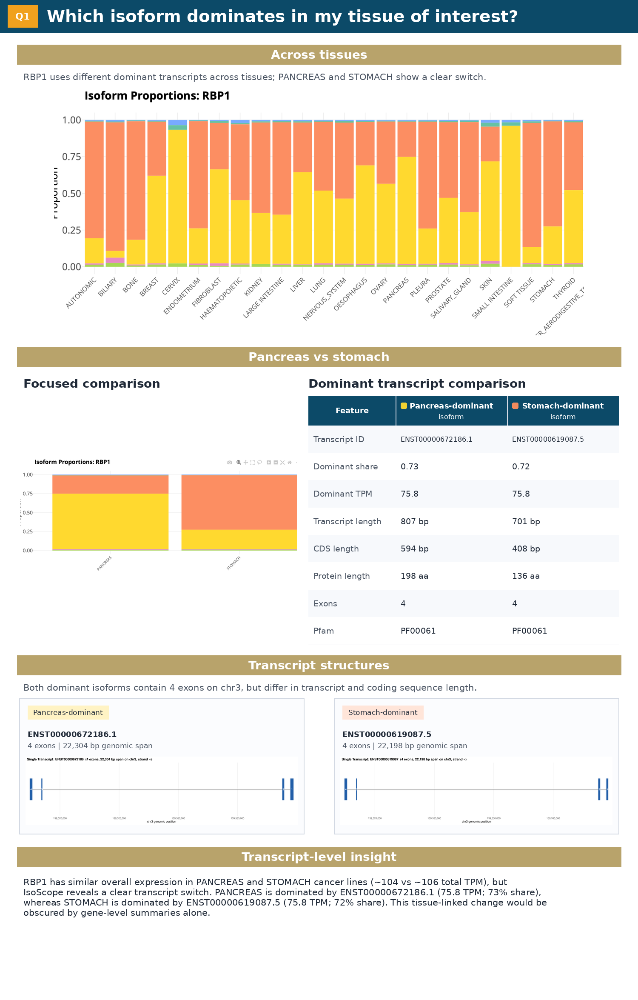
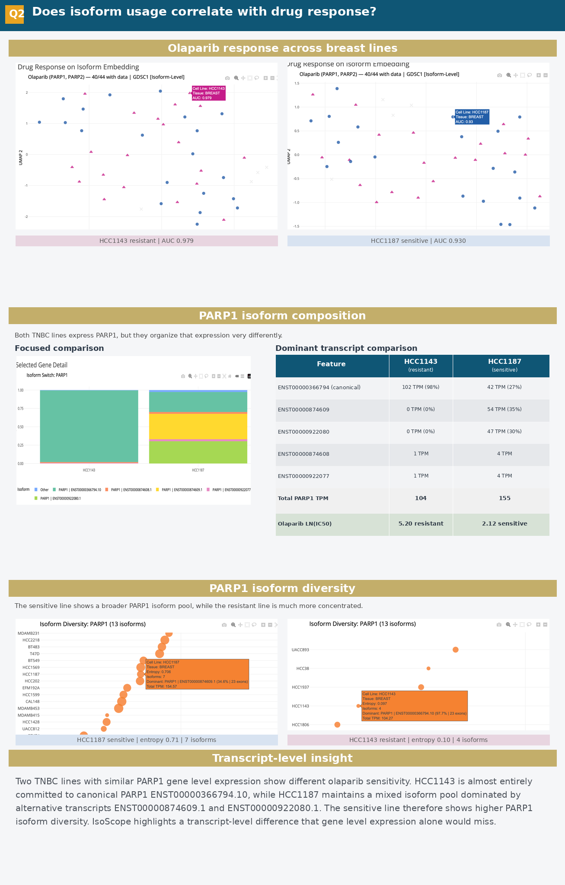
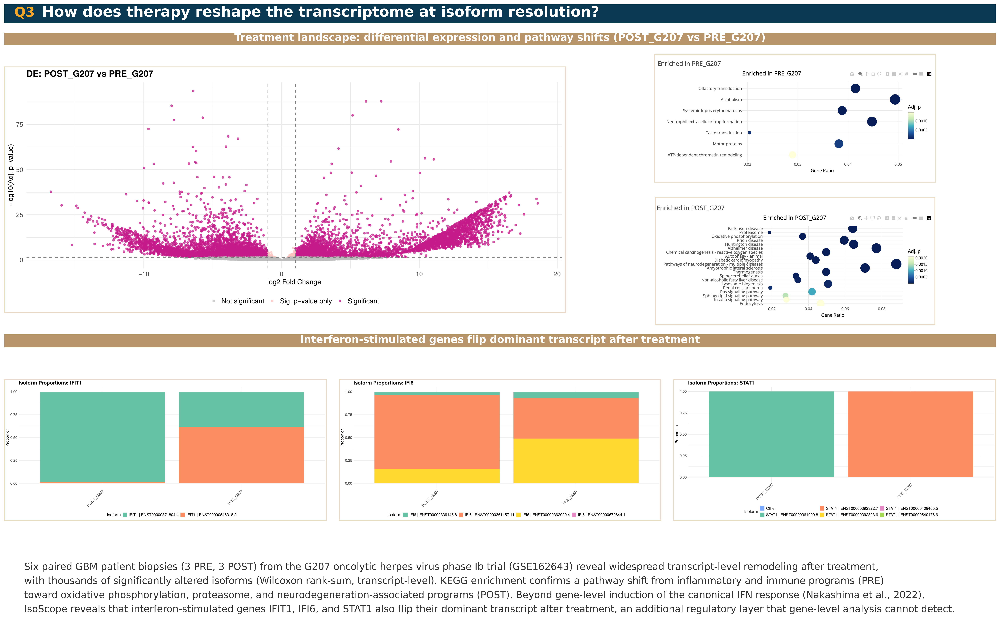

# IsoScope

*Interactive visualization of transcript isoform expression across cancer cell lines*

**Live application:** <https://huggingface.co/spaces/HorvathLab/IsoScope>

**Source code:** <https://github.com/HorvathLab/IsoScope>

**Data:** <https://zenodo.org/records/19475049>

## Overview

Alternative splicing can produce structurally and functionally distinct isoforms from the same gene, introducing variation that is not captured by gene-level expression summaries. A textbook example is BCL2L1, where alternative splicing produces BCL-XL, which protects cells from apoptosis, and BCL-XS, which promotes it (Dou et al., 2021). Same gene, opposite roles in cell survival, depending on a single splicing decision. Cancer cells routinely exploit this kind of switch to evade therapy, sustain growth, and adapt to new tissue environments. Despite this, most cancer transcriptomics resources still report a single expression value per gene, collapsing the very signal that distinguishes one isoform from another.

IsoScope is an R/Shiny application for interactive exploration of isoform-level expression across **667 cancer cell lines from the Cancer Cell Line Encyclopedia (CCLE)**, covering **26 tissue types**, with optional overlay of **6 glioblastoma patient samples** (28 tissue groups, 673 samples total). The application links isoform expression to drug sensitivity from GDSC1 and GDSC2, detects isoform switching between tissues, quantifies per-gene isoform diversity, visualizes exon-level structural differences across isoforms, and supports overlay of external datasets for translational context. All analyses are accessible through a point-and-click interface without writing code.

## Use Cases

Here we present use cases as worked examples to answer three biologically important questions. In the first two cases, the analysis reflects differential isoform usage even when overall gene expression is very similar. In glioblastoma, the key signal is that after therapy, dominant isoforms switch, revealing transcript-level remodeling that gene-level summaries alone would miss.

### Q1. Which isoform dominates in each tissue?


RBP1 shows similar total expression in pancreas and stomach cancer lines (~104 vs ~106 TPM), but uses different dominant transcripts. Pancreas is dominated by ENST00000672186.1 (73%), whereas stomach is dominated by ENST00000619087.5 (72%). Both are protein-coding and share the same Pfam domain, but differ in transcript structure and coding sequence length. Gene-level summaries would make these samples look nearly identical, while transcript-level analysis reveals a clear tissue-linked isoform switch.

### Q2. How does isoform usage vary with drug response?


Two TNBC lines with similar total PARP1 expression show markedly different olaparib sensitivity. HCC1143 (resistant, ln IC50 5.20) is almost entirely committed to canonical PARP1 ENST00000366794.10 (98%). In contrast, HCC1187 (sensitive, ln IC50 2.12) maintains a mixed isoform pool, with ENST00000874609.1 (35%) and ENST00000922080.1 (30%) exceeding the canonical transcript (27%). This contrast is also reflected in isoform diversity, with normalized Shannon entropy of 0.10 in HCC1143 versus 0.71 in HCC1187. Gene-level PARP1 expression alone would not explain this difference, but isoform-level analysis reveals a transcript-organization pattern associated with drug response.

### Q3. How does therapy reshape the transcriptome at isoform resolution?


Paired glioblastoma biopsies from 3 patients before and after G207 oncolytic HSV therapy (GSE162643) show widespread transcript-level remodeling after treatment. Differential transcript analysis identifies thousands of altered isoforms, and KEGG enrichment shows a shift from inflammatory and immune-associated programs in PRE samples toward oxidative phosphorylation, proteasome, and neurodegeneration-associated programs in POST samples. In addition, interferon-stimulated genes including IFIT1, IFI6, and STAT1 switch their dominant transcript after therapy. Together, these results show that treatment reshapes not only pathway activity, but also isoform choice within individual genes.

## Features

- **Gene Viewer**: Stacked bar, grouped bar, and heatmap views of isoform expression across tissues or individual cell lines
- **Isoform Switching**: Detect changes in dominant isoform between tissue groups or cell lines, with bootstrap confidence intervals
- **Isoform Diversity**: Normalized Shannon entropy quantifying how evenly isoforms are expressed per gene per tissue
- **Isoform Exon Structure**: Tile-grid visualization of every isoform's exon composition for any gene, with click-to-zoom into a single-transcript detail view showing real genomic proportions and per-exon coordinates. Available in Diversity, Tissue-Specific, and Switching tabs.
- **Tissue-Specific Isoforms**: Identify transcripts predominantly expressed in a single tissue, with optional gene-name search
- **Clustering**: PCA and UMAP embeddings at isoform or gene level, with external data projection
- **Tissue Correlation**: Pairwise correlation heatmaps across tissues or cell lines
- **Drug Response**: GDSC1/GDSC2 drug sensitivity overlaid on expression embeddings
- **Differential Expression**: Precomputed DESeq2 (325 tissue pairs + 1 GBM pair) and runtime Wilcoxon tests
- **Pathway Enrichment**: KEGG enrichment via clusterProfiler, directional from DE or pooled from switching
- **Circos**: Genome-wide isoform expression landscape with switching event overlay
- **QC & Distribution**: Per-sample quality metrics across tissue types

## Data

- **CCLE RNA-seq:** 667 cell lines, 26 tissues (BioProject [PRJNA523380](https://www.ncbi.nlm.nih.gov/bioproject/PRJNA523380))
- **Alignment:** STAR 2.7.2a, GRCh38, GENCODE v49 basic annotation
- **Quantification:** Salmon 1.10.0 (alignment-based mode)
- **Drug response:** GDSC1 (378 drugs) and GDSC2 (286 drugs) via [Cell Model Passports](https://cellmodelpassports.sanger.ac.uk/downloads)
- **Annotations:** GENCODE v49 (biotype, exons, length, per-exon coordinates), Ensembl BioMart release 115 (UniProt, Pfam, InterPro)
- **External dataset:** 6 glioblastoma patient samples from [GSE162643](https://www.ncbi.nlm.nih.gov/geo/query/acc.cgi?acc=GSE162643) (pre/post G207 oncolytic HSV treatment)

## Running Locally

The simplest way to use IsoScope is the [live Hugging Face Space](https://huggingface.co/spaces/HorvathLab/IsoScope). To run a local copy:

**Prerequisites:**

- R >= 4.2
- Bioconductor packages: `DESeq2`, `clusterProfiler`, `org.Hs.eg.db`
- CRAN packages: `shiny`, `ggplot2`, `plotly`, `DT`, `dplyr`, `tidyr`, `data.table`, `DBI`, `RSQLite`, `uwot`, `bslib`, `circlize`, `RColorBrewer`

```bash
git clone https://github.com/HorvathLab/IsoScope.git
cd IsoScope
```

Cloning the repository brings the smaller reference files in `data/` with it. The large expression matrices and DESeq2 database must be downloaded separately from Zenodo (<https://zenodo.org/records/19475049>) and placed in `shiny_data/` alongside the files copied from `data/`.

**Files included in the repository (`data/`):**

| File | Description |
|------|-------------|
| `sample_metadata.csv` | Sample-to-tissue mapping (673 rows) |
| `tissue_avg.csv` | Tissue-averaged expression |
| `diversity_range.csv` | Per-gene entropy range across tissues |
| `transcript_annotations.csv` | Biotype, exon count, transcript length |
| `transcript_coords.csv` | Genomic coordinates for Circos |
| `transcript_exons.csv.gz` | Per-exon coordinates from GENCODE v49 |
| `protein_annotations_collapsed.csv` | UniProt, Pfam, InterPro per transcript |
| `enst_to_refseq.csv` | ENST-to-RefSeq NM mapping (53,946 entries) |
| `gdsc1_matched.csv` | GDSC1 drug response matched to CCLE |
| `gdsc2_matched.csv` | GDSC2 drug response matched to CCLE |
| `biomart_tx_info.csv`, `biomart_pfam.csv`, `biomart_interpro.csv` | Raw BioMart pulls (intermediate, not loaded at runtime) |

**Files to download from Zenodo:**

| File | Size | Description |
|------|------|-------------|
| `quants.db` | 867 MB | Transcript TPM matrix (SQLite, 32,766 transcripts x 673 samples) |
| `deseq2.db-001.zip` | 3.7 GB | Precomputed DESeq2 results (unzip to `deseq2.db`) |
| `dominant_isoforms.csv` | 112 MB | Dominant isoform per gene per tissue with bootstrap CIs |
| `tpm_matrix.txt.gz` | 116 MB | Gene-level TPM from STAR (for gene-level clustering) |
| `all_quants_all_ENST.csv` | ~1 GB | Transcript TPM matrix (CSV, used as input for the integration workflow) |

Copy the contents of `data/` into `shiny_data/` (or symlink it), then place the Zenodo downloads in the same folder. Unzip `deseq2.db-001.zip` to produce `deseq2.db`.

**Launch:**

```r
shiny::runApp()
```

## Integrating Your Own Data

IsoScope supports overlaying external RNA-seq datasets onto the CCLE reference. See [`docs/INTEGRATION.md`](docs/INTEGRATION.md) for the step-by-step walkthrough covering Salmon quantification against GENCODE v49, merging with the CCLE TPM matrix, rebuilding `quants.db` with your samples, and registering your tissue groups in `app.R`.

## Pipeline Scripts

All preprocessing scripts are in `scripts/`:

| # | Script | Description |
|---|--------|-------------|
| 01 | `build_count_matrix.py` | tx2gene mapping + Salmon count and TPM matrices |
| 02 | `build_gene_counts.py` | STAR gene-level count matrix |
| 03 | `calculate_gene_tpm.R` | Gene counts to TPM |
| 04 | `extract_transcript_metadata.py` | Transcript annotations + genomic coordinates from GTF |
| 05 | `pull_protein_annotations.R` | UniProt, Pfam, InterPro from BioMart |
| 06 | `match_gdsc_response.py` | GDSC drug data matching to CCLE |
| 07 | `preprocess_for_shiny.py` | Build SQLite database + all app-ready tables |
| 08 | `run_deseq2_pairwise.R` | Pairwise DESeq2 + SQLite database |
| 09 | `integrate_external_dataset.R` | RefSeq-to-ENST mapping + external data integration |
| 10 | `extract_transcript_exons.py` | Per-exon coordinates from GENCODE GTF |

## License

Released under the MIT License. See `LICENSE` for full text.

## References

See the associated publication for full methodological details and references:

Sajjad A, Martinez S, Johnson L, Ballesteros Prieto V, Arestakesyan H, Dias J, Alhossiny M, and Horvath A. *IsoScope: Interactive Pan-Cancer Isoform-Level Analysis Integrating CCLE and User-Defined RNA-seq Data.* Bioinformatics, 2026.

## Contact

Horvath Lab, Department of Biochemistry and Molecular Medicine, The George Washington University.
